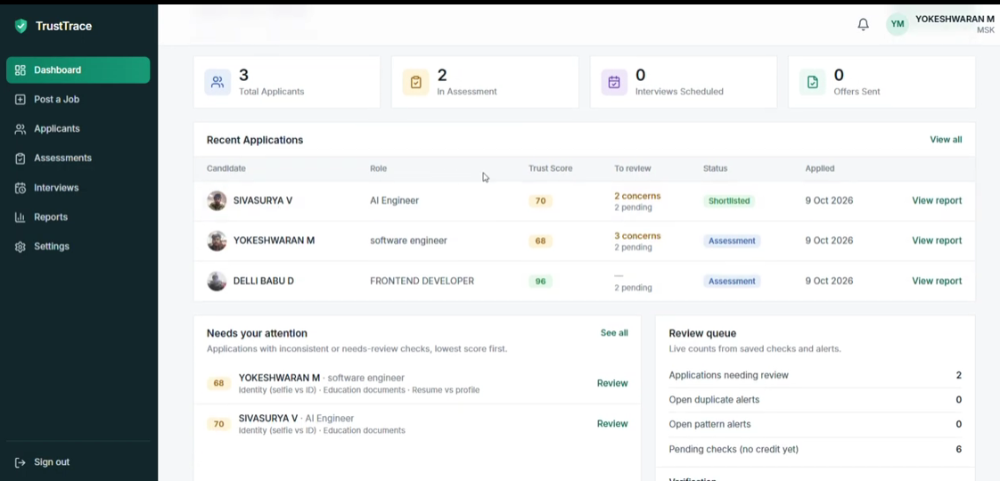
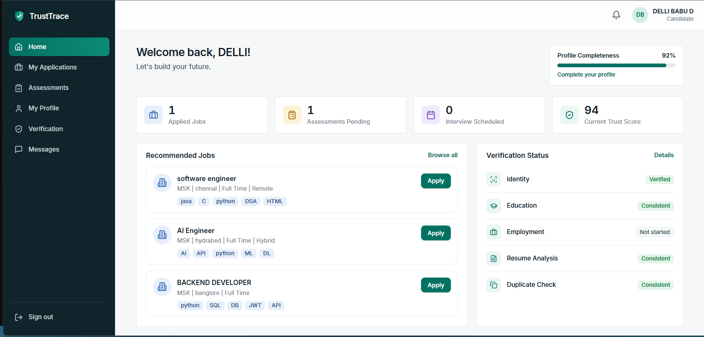
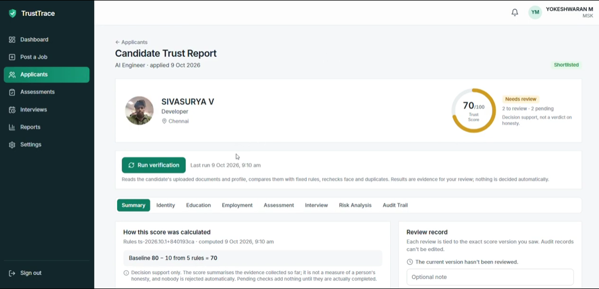

# TrustTrace

**Candidate Trust & Fraud Intelligence Platform**
_Evidence you can inspect. Decisions people make._

Built for **KERNEL PRIME'26 · Problem Statement SW-03** by **Team NEXTGEN MINDS**.

## Screenshots

| Recruiter dashboard                                               | Candidate dashboard                                              |
| ----------------------------------------------------------------- | ---------------------------------------------------------------- |
|  |  |

**Explainable trust score**



---

## The problem

Recruiters can't easily tell whether a candidate is genuine:

- **Fake certificates**: edited marks, names or years
- **Proxy candidates**: someone else takes the test or interview
- **Duplicate profiles**: one person using many accounts
- **Slow manual checks**: calls and emails take days or weeks

## The solution

TrustTrace is a web platform that checks candidates and **explains every result**:

| Feature                        | What it does                                                                                                       |
| ------------------------------ | ------------------------------------------------------------------------------------------------------------------ |
| 📄 **Document verification**   | Reads resumes, marksheets and experience letters (text + OCR) and compares each field with the candidate's profile |
| 🏛️ **DigiLocker comparison**   | With consent, fetches the issuer's original certificate and compares it with the upload                            |
| 🙂 **Face matching**           | Confirms the same person at registration (selfie vs ID), during the test and before the interview                  |
| 🚩 **Fraud detection**         | Flags duplicate accounts (same phone / similar face), suspicious patterns and linked-account groups                |
| 📝 **Proctored skill test**    | Records tab switches, paste events and camera loss on a timeline for review                                        |
| ⚖️ **Explainable trust score** | Starts at 80; every point added or removed shows its rule, evidence and time                                       |
| 🔗 **Evidence chain**          | Every event is hash-linked, so any edit or deletion is detected                                                    |
| 🔳 **QR trust passport**       | A signed, minimal-data passport any employer can verify by scanning                                                |

> **A recruiter makes every decision.** TrustTrace never rejects a candidate automatically, and never calls a pending or simulated check "verified".

---

## Architecture

```
Candidate / Recruiter / Verifier (browser)
              │  HTTPS (Cloudflare Tunnel for demos)
              ▼
┌──────────────── TrustTrace Server (FastAPI) ────────────────┐
│                       React Web App                         │
│  Document Verification │ Face Match (ML) │ Fraud Detection  │
│  Skill Assessment      │ Trust Score     │ Evidence + QR    │
└─────────────────────────────────────────────────────────────┘
              │                                   ▲▼ OAuth + document pull
              ▼                                   DigiLocker API (with consent)
   SQLite database + private file storage
```

**Flow:** Upload → Verify → Detect → Score → Recruiter decides

---

## Tech stack

| Layer       | Technology                                                                 |
| ----------- | -------------------------------------------------------------------------- |
| Frontend    | React 19, TypeScript, Tailwind CSS (pre-built into `frontend/dist`)        |
| Backend     | Python, FastAPI, SQLAlchemy, Alembic                                       |
| Database    | SQLite (PostgreSQL-ready)                                                  |
| Documents   | PyMuPDF, Tesseract OCR                                                     |
| Face ML     | OpenCV YuNet (detection) + SFace (recognition, 128-d embeddings)           |
| Fraud graph | NetworkX                                                                   |
| Security    | Argon2id, JWT, Fernet encryption, SHA-256 + HMAC chain, Ed25519 signatures |
| QR code     | OpenCV `QRCodeEncoder`                                                     |
| Integration | DigiLocker Requester API (OAuth 2.0 + PKCE)                                |

---

## How detection works

| Check               | Technique                                                           | Result                                          |
| ------------------- | ------------------------------------------------------------------- | ----------------------------------------------- |
| Edited certificate  | Text extraction / OCR → regex fields → rule comparison with profile | Match · Mismatch (with evidence) · Needs review |
| DigiLocker          | Issuer XML (HMAC-checked) compared field by field with the upload   | Match **+8** · Mismatch **−15**                 |
| Wrong person        | Face embeddings, cosine similarity (≥ 0.363 = same person)          | Match · Uncertain · Needs review                |
| Duplicate profile   | Same OTP-verified phone, or face similarity ≥ 0.50                  | Duplicate alert                                 |
| Suspicious patterns | Rules P1–P5 (e.g. 5 applications in 10 minutes, shared browser)     | Pattern alert with possible innocent reasons    |
| Test cheating       | Browser focus / paste / camera events + live face recheck           | Review signals on a timeline                    |
| Record tampering    | `hash = SHA-256(event)`, `link = HMAC(key, prev_link + hash)`       | Exact broken event reported                     |
| Fake passport       | Ed25519 signature, expiry and revocation check                      | Valid · Could not be verified                   |

**Trust score** = 80 + Σ rule weights, kept within 0–100. Pending and simulated checks add 0.

---

## Getting started

### Requirements

- **Python 3.11+** (Node.js is not needed; the frontend is pre-built)
- **Tesseract OCR** (optional, needed only for scanned documents)
  Windows: install from the [UB Mannheim build](https://github.com/UB-Mannheim/tesseract/wiki)

### Install and run

```bash
cd trusttrace
python -m pip install -r backend/requirements.txt
python backend/manage.py doctor      # checks PyMuPDF, OCR, face models
python serve.py
```

Open **http://localhost:5173**.
On Windows you can double-click **`start.bat`** instead (`start.sh` on Linux/macOS).

The database starts **empty**: no demo users or hardcoded results.

### First steps

1. Register a **recruiter** account, then approve its organisation:

```bash
   python backend/manage.py approve-org recruiter@example.com
```

2. Post a job as the recruiter.
3. Register a **candidate** (mobile OTP codes are printed in the server window), then apply.
4. Generate sample documents for any name:

```bash
   python backend/manage.py make-sample-docs "Your Name" demo-docs
```

---

## Configuration

Copy `.env.example` to `.env` (next to `serve.py`). Every setting is optional.

| Setting                                                               | Purpose                                              |
| --------------------------------------------------------------------- | ---------------------------------------------------- |
| `PORT`                                                                | Web server port (default `5173`)                     |
| `HOST=0.0.0.0`                                                        | Let other devices on the same Wi-Fi open the site    |
| `TT_PUBLIC_URL`                                                       | Public address printed in passport QR codes          |
| `TT_TESSERACT_CMD`                                                    | Full path to `tesseract.exe` if it isn't on PATH     |
| `TT_AUTO_APPROVE_ORGS=1`                                              | Demo only: approve recruiter organisations instantly |
| `TT_PASSPORT_TTL_DAYS`                                                | Passport validity (default 90 days)                  |
| `TT_DIGILOCKER_MODE` / `CLIENT_ID` / `CLIENT_SECRET` / `REDIRECT_URI` | DigiLocker settings (simulated mode if unset)        |
| `TT_DATABASE_URL`                                                     | Use PostgreSQL instead of SQLite                     |

Keys are generated once into `backend/data/`. **Back up that folder**: losing `evidence.key` makes old chain entries unverifiable, and losing `passport_ed25519.pem` invalidates issued passports.

---

## Sharing the demo

**Same Wi-Fi:** set `HOST=0.0.0.0` in `.env`, restart, and open `http://<your-laptop-IP>:5173` on another device.

**Public HTTPS link** (needed for the webcam on other devices):

```bash
cloudflared tunnel --url http://localhost:5173
```

Set `TT_PUBLIC_URL` to the printed `https://….trycloudflare.com` link so QR codes point to it. Keep the laptop awake: the free link changes on every restart.

---

## Admin commands

Run from the project folder: `python backend/manage.py <command>`

| Command                                                   | Purpose                                                 |
| --------------------------------------------------------- | ------------------------------------------------------- |
| `init-db`                                                 | Create or upgrade the database                          |
| `doctor`                                                  | Check OCR, PDF and face-model setup                     |
| `list-orgs` / `approve-org EMAIL` / `suspend-org EMAIL`   | Manage recruiter organisations                          |
| `run-verification EMAIL`                                  | Re-run all checks for a candidate                       |
| `verify-chain EMAIL`                                      | Check a candidate's evidence chain for tampering        |
| `make-sample-docs "Name" FOLDER`                          | Generate sample resume, marksheet and experience letter |
| `load-digilocker-records FILE.csv`                        | Load **simulated** DigiLocker records (demo only)       |
| `load-issuer-records FILE.csv`                            | Load **simulated** issuer records (demo only)           |
| `delete-biometrics EMAIL`                                 | Delete a candidate's face data                          |
| `erase-candidate EMAIL --yes`                             | Erase a candidate's personal data (right to erasure)    |
| `purge-extractions DAYS` / `purge-assessment-events DAYS` | Data-retention cleanup                                  |

---

## Project structure

```
trusttrace/
├── serve.py               # starts the server (API + frontend)
├── start.bat / start.sh   # one-click start
├── .env.example           # all settings
├── PROJECT_STATUS.md      # feature matrix, judge demo, troubleshooting
├── backend/
│   ├── manage.py          # admin commands
│   ├── requirements.txt
│   ├── migrations/        # Alembic database migrations
│   ├── models/            # face ML model files (YuNet, SFace)
│   ├── tests/             # automated tests
│   └── app/
│       ├── main.py        # FastAPI app, security middleware
│       ├── routers/       # API endpoints
│       ├── verification/  # documents, OCR, face, DigiLocker
│       ├── fraud/         # duplicates, patterns, graph, scoring
│       ├── skills/        # proctored assessment
│       └── evidence/      # hash chain, QR passport
└── frontend/
    ├── src/               # React + TypeScript source
    ├── dist/              # pre-built app served by serve.py
    └── tests/             # end-to-end demo tests
```

---

## Testing

```bash
cd backend
python -m pytest
```

- **74** backend tests passing
- **37 / 37** end-to-end demo checks passing, starting from an empty database

---

## Security and privacy

- Passwords hashed with **Argon2id**; sessions use signed **JWT** tokens
- Face embeddings **encrypted** (Fernet); device IDs stored only as hashes
- **Consent recorded** for webcam and DigiLocker; withdrawing consent removes the data
- Secrets kept in `.env`, never in code or logs; documents and embeddings are never logged
- CSP headers, request-size limits, PDF page and image-size limits, rate limiting
- QR passport holds **no** photos, ID numbers, phone numbers or face data

## Honest limitations

- **DigiLocker** runs in a clearly labelled **simulated** mode until partner approval is granted. Simulated results never count as verified.
- There is **no liveness or anti-spoofing** check yet; a printed photo could fool the face check.
- No government database is queried.
- A local hash chain cannot fully protect against an administrator who controls both the server and its keys. External anchoring is planned.
- The free Cloudflare quick-tunnel link is for demos only.

## Future work

- Real DigiLocker partner access
- Liveness detection SDK
- Cloud deployment with PostgreSQL and a fixed domain
- External anchoring of the evidence chain

---

## Team

**NEXTGEN MINDS**, KERNEL PRIME'26 · SW-03

> _TrustTrace makes hiring faster, fairer and harder to fake._
